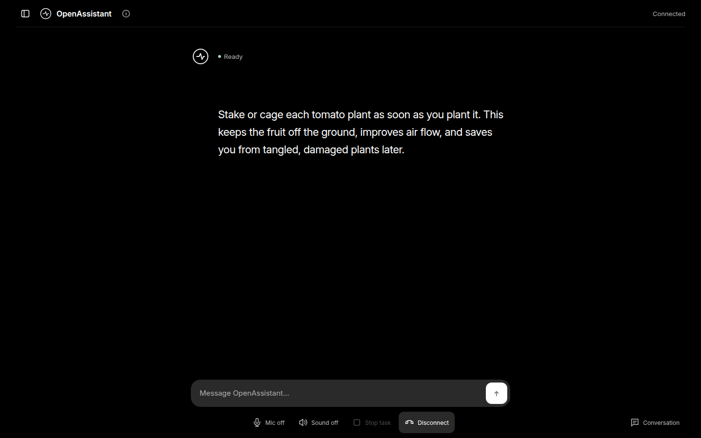
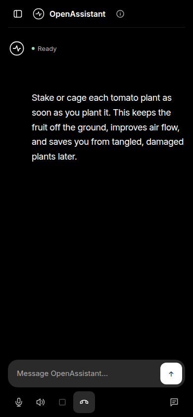

# OpenAssistant

https://github.com/user-attachments/assets/737b21a3-9982-40ae-8082-d6e7b13fbcda

*Watch the 45-second preview. Music: [Sascha Ende, ende.app](https://ende.app/en) ([CC BY 4.0](https://creativecommons.org/licenses/by/4.0/)); adapted for this film.*

OpenAssistant started in 2023 as a desktop experiment in running open models locally. The original app combined GGUF language models, voice and an early LLaVA image experiment. You can still explore it in the [v1_2023 release](https://github.com/has-c/openassistant/releases/tag/v1_2023).

The new preview revisits that idea with today's tools: a browser interface for text and voice, a Pi agent that can use tools and MCP, and a choice of models through Pi—including local models served with vLLM.



*The current preview, showing a response from a local model.*

## From 2023 to now

| | [2023 release](https://github.com/has-c/openassistant/releases/tag/v1_2023) | Current preview |
| --- | --- | --- |
| Interface | Desktop app | Browser-based text and voice |
| Models | Local GGUF models | Models configured in Pi, including local vLLM providers |
| Voice | Early voice chat | Whisper transcription and Kokoro speech, run as separate services |
| Capabilities | Chat and experimental LLaVA image interpretation | Pi's read, shell, edit and write tools, plus configured MCP servers |
| History | Original desktop experience | Saved conversations, with SQLite and Pi session files |

The preview is experimental. It does not import conversations from the original release. Model and tool capabilities depend on your Pi configuration.



## Try the preview

You'll need Python 3.12, Node.js, a compatible Pi CLI, Docker, and a model configured in Pi. Install the app:

```sh
python -m pip install ./openassistant-live
pi --version
```

Start the speech services:

```sh
docker compose -f speech/compose.yaml up -d
docker compose -f speech/whisper/compose.yaml up -d --build
```

Create an access file containing a JSON object that maps names to random access keys of at least 32 characters. Give the file mode `0600`, then start the app:

```sh
python -m openassistant.live --access-file /path/to/access.json \
  --workspace /path/to/workspace \
  --speech-endpoint http://127.0.0.1:8880/v1/audio/speech \
  --whisper-endpoint http://127.0.0.1:9000/transcribe
```

Open `http://localhost:8766`. The app uses Pi's default provider and model; use `--pi-provider` and `--model` to select others. For local vLLM, configure a Pi provider for its OpenAI-compatible Chat Completions endpoint and served model.

See [preview setup](MIGRATION.md) for remote access, history, and service details.

## Tool access

Pi's standard tools, configured MCP servers and extensions are enabled for conversations. They run with the app user's permissions, without a per-action approval prompt or an additional sandbox. Use a dedicated account and workspace, and restrict access to people you trust. No MCP server is bundled. Title generation runs separately with tools disabled. Configured Pi extensions can request confirmation or input in the app; a chime calls attention to the request. Sound options let you choose voice and alerts, alerts only, or silence. These extension requests do not add approval prompts to Pi’s standard tools.

## The original app

The 2023 release and its [source](https://github.com/has-c/openassistant/tree/v1_2023) remain available. It used local GGUF models and included an experimental LLaVA image workflow.
