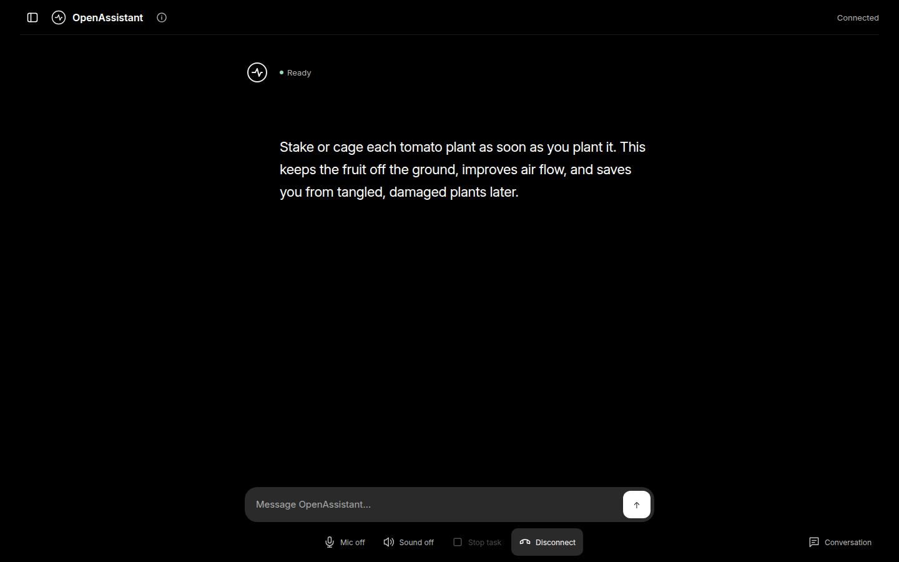
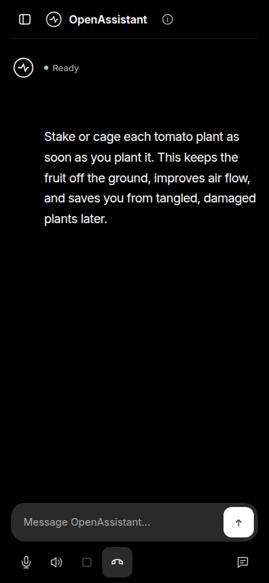

# OpenAssistant

https://github.com/user-attachments/assets/68b13f4f-a961-443c-86e5-6a94db5357da

*Watch the 50-second preview. Music: [Sascha Ende, ende.app](https://ende.app/en) ([CC BY 4.0](https://creativecommons.org/licenses/by/4.0/)); adapted for this film.*

OpenAssistant started in 2023 as a desktop experiment in running open models locally. The original app combined GGUF language models, voice and an early LLaVA image experiment. You can still explore it in the [v1_2023 release](https://github.com/has-c/openassistant/releases/tag/v1_2023).

The new preview revisits that idea with today's tools: a browser interface for text and voice, a Pi agent that can use tools and MCP, and a choice of models through Pi—including local models served with vLLM.



*The current preview, showing a response from a local model.*

## From 2023 to now

| | [2023 release](https://github.com/has-c/openassistant/releases/tag/v1_2023) | Current preview |
| --- | --- | --- |
| Interface | Desktop app | Browser-based text and voice |
| Models | Local GGUF models | Models configured in Pi, including local vLLM providers |
| Voice | Early voice chat | Whisper transcription and Kokoro speech, run as separate services |
| Capabilities | Chat and experimental LLaVA image interpretation | Pi's read, shell, edit and write tools, plus configured MCP servers |
| History | Original desktop experience | Saved conversations, with SQLite and Pi session files |

The preview is experimental. It does not import conversations from the original release. Model and tool capabilities depend on your Pi configuration.



## Try the preview

You'll need Python 3.12, Node.js, a compatible Pi CLI, Docker, and a model configured in Pi. Install the app:

```sh
python -m pip install ./openassistant-live
pi --version
```

Start the speech services:

```sh
docker compose -f speech/kokoro/compose.yaml up -d
docker compose -f speech/whisper/compose.yaml up -d --build
```

Create an access file containing a JSON object that maps names to random access keys of at least 32 characters. Give the file mode `0600`, then start the app:

```sh
python -m openassistant.live --access-file /path/to/access.json \
  --workspace /path/to/workspace \
  --speech-endpoint http://127.0.0.1:8880/v1/audio/speech \
  --whisper-endpoint http://127.0.0.1:9000/transcribe
```

Open `http://localhost:8766`. The app uses Pi's default provider and model; use `--pi-provider` and `--model` to select others. For local vLLM, configure a Pi provider for its OpenAI-compatible Chat Completions endpoint and served model.

The header now lets you choose a model and thinking effort for each conversation.
Choices come from Pi and apply to the next message, including queued messages;
work already running keeps its settings. Default restores the configured app/Pi
model. Use Pi CLI 1.3 or later for the bundled plan extension and thinking catalogue.

Chats groups active work first. Requests collects your browser's pending Pi
extension confirmations and questions across conversations. You can attach or
paste up to five images per message (4 MiB each) when the selected model accepts
images. Multi-step work can publish a task plan, and tasks have no fixed overall
time limit. A configurable inactivity watchdog stops Pi after 30 minutes without
progress; extension answer waits pause it. Set `--inactivity-timeout 0` to disable,
or choose a longer duration for silent tools. Stop remains available; disconnecting
leaves accepted work running.

Double-tap Control to toggle the microphone, or Alt/Option to stop a task.
Ctrl/Command+Enter sends guidance from the composer or confirms a focused request.
These controls also work on reopened conversations; requests never take keyboard
focus from your draft.

See [preview setup](MIGRATION.md) for remote access, history, and service details.

## Tool access

Pi's standard tools, configured MCP servers and extensions are enabled for conversations. They run with the app user's permissions, without a per-action approval prompt or an additional sandbox. Use a dedicated account and workspace, and restrict access to people you trust. No MCP server is bundled. Title generation runs separately with tools disabled. Configured Pi extensions can request confirmation or input in the app; a chime calls attention to the request. Sound options let you choose voice and alerts, alerts only, or silence. These extension requests do not add approval prompts to Pi’s standard tools.

## The original app

The original desktop scripts and packaging are in [legacy/](legacy/). The [2023 release](https://github.com/has-c/openassistant/releases/tag/v1_2023) preserves the original version. It used local GGUF models and included an experimental LLaVA image workflow.
